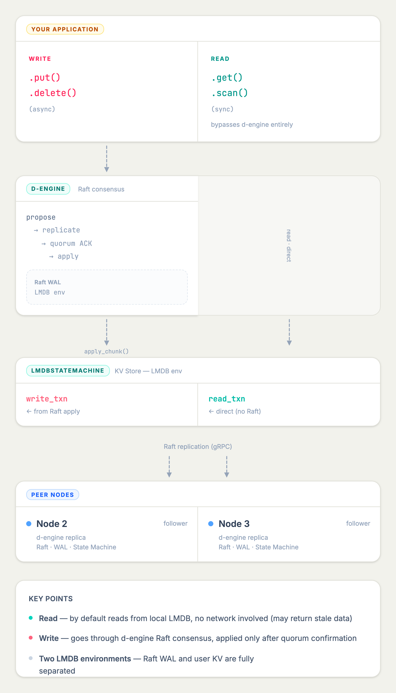

I’m happy to open source [d-lmdb](https://github.com/deventlab/d-lmdb). This is still an experimental project. The goal is to try using d-engine’s distributed capability to “wrap” an existing KV store.

There are already many Raft-based distributed KV systems in the community (many written in Go). d-engine itself is not a KV database, but in my actual work I do need a simple and reliable KV store. So I chose LMDB, which is well-known and stable, to run this experiment. If this approach works, I can also use it directly.

After putting the architecture together, one thing became quite clear: adding a “consensus-based write path” to a single-node KV is actually feasible, and more straightforward than I initially expected. Of course, most of the complexity still comes from the nature of distributed systems vs single-node systems. More details will likely show up during real usage.

---

## What d-lmdb is (and is not)

d-lmdb is an experimental project. The core path is working, and it can be used for evaluation and testing, but it is not production-ready.

It is also trying to answer a question: can [d-engine](https://github.com/deventlab/d-engine) be reused on top of an existing storage engine to provide a “replicated write path”? LMDB is the first working example. In theory, the same pattern should also work with other embedded storage engines (not fully verified yet).

---

## Architecture



---

## Simplified model

d-engine runs in embedded mode, without a separate server process (each node is a peer process). Reads bypass the consensus layer and go directly to the local LMDB instance:

```text
Your process
    │
    ├─ db.get(key)      ────────────────► Local LMDB (sync, local read)
    │
    └─ db.put(key, val) ──► d-engine Raft ──► Local LMDB (async, replicated)
                             leader election
                             log replication
                             quorum commit
```

---

## Core idea

This design adds a distributed write path to an existing storage engine.

By default, get() reads locally without linearizability guarantees. If you need linearizable reads, d-lmdb also provides get_linearizable(), which is backed by d-engine’s ReadIndex / lease-read and goes through the Raft layer.

For example:

```rust
// LMDB (before)
let val = txn.get(db, &key)?;

// d-lmdb (after)
let val = db.get(&key)?;   // still sync, still local read
```

The unavoidable change is that writes become async:

```rust
db.put(b"user:1", b"alice").await?;
db.delete(b"user:1").await?;
```

This pattern — “local reads, consensus writes” — is what d-engine is trying to demonstrate. It is not tied to a specific KV implementation, but can be reused on top of other storage engines.

---

## What d-lmdb solves

- Single point of failure → quorum fault tolerance
  Writes go through Raft. As long as a majority of nodes are alive, the system can continue serving. Native LMDB has no replication, and recovery from node failure can be difficult.

- Strong consistency across nodes (for writes)
  All nodes share the same linearizable write history. The only additional dependency is d-engine itself.

- Read performance is not affected
  `get()` reads directly from local LMDB, so read latency is not impacted by replication. However, reads are not guaranteed to be linearizable.

---

## What d-lmdb does NOT solve

- Write throughput will not improve
  A local LMDB write is one fsync. A d-lmdb write is a network round-trip plus quorum fsync. This trades latency and throughput for availability and consistency (which is expected in distributed systems).

- No sharding
  d-engine replicates data but does not partition it. Each node stores the full dataset.

- Still just a KV store
  Adding Raft does not add relational modeling or complex queries.

- Operational complexity
  Raft introduces real operational concerns: leader election, membership changes, snapshots, log compaction, etc.

---

## Current status

d-lmdb is still in an early stage. The core functionality works and can be used for evaluation and experiments. Feedback is very welcome.

It has not been validated in production yet, and both API and internal behavior may change.

If you are looking for a production-ready distributed KV, this is not there yet. But if you want to see what it looks like to “add a replicated write path” to an existing storage engine, d-lmdb can serve as a concrete example.

---

## Final note

d-lmdb is not the end goal. If you already have your own storage engine or application and want a similar model (“local reads + consensus writes”), you can use d-lmdb as a reference or starting point.

d-lmdb itself is just one concrete implementation of that pattern. The more general part lives in [d-engine](https://github.com/deventlab/d-engine).

Code: [https://github.com/deventlab/d-lmdb](https://github.com/deventlab/d-lmdb)
Issues and PRs are welcome.
