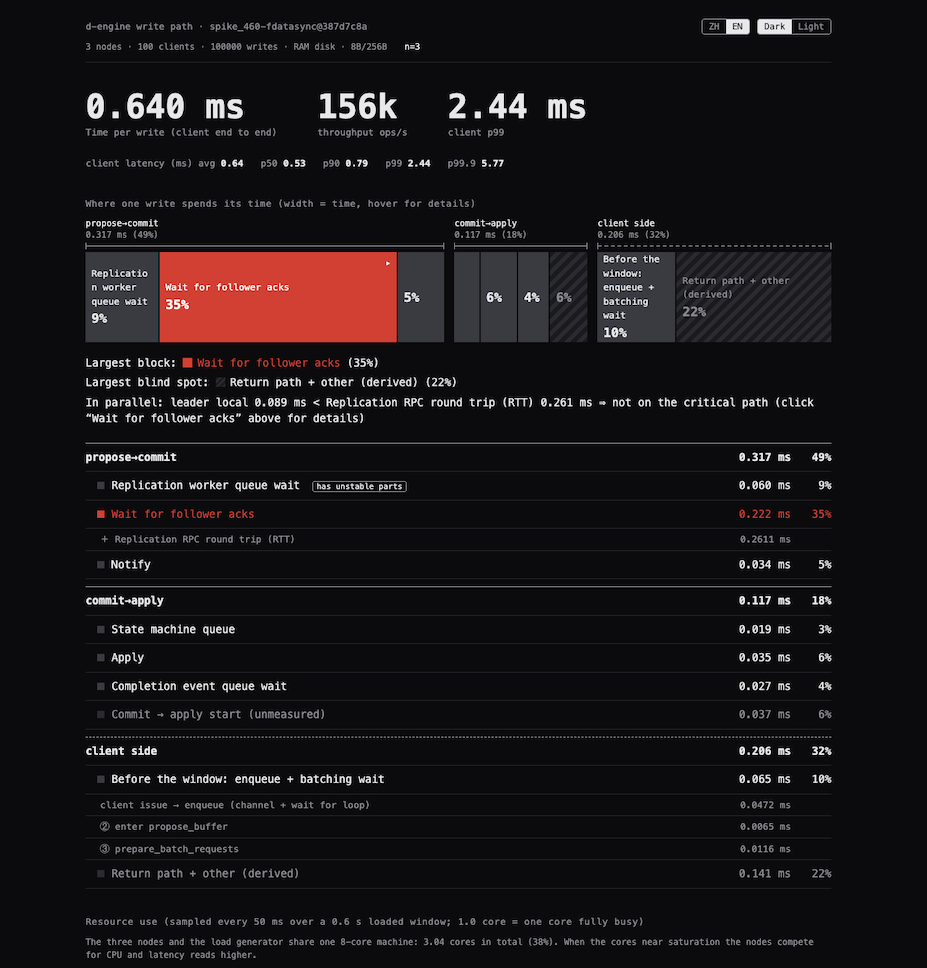

## Want

To explain where [d-engine](https://github.com/deventlab/d-engine) really came from, I have to go back four or five years — to before d-engine itself existed.

The first time I came across Kafka — especially Kafka Streams and Kafka Connect — I got hooked on event streaming platforms: pulling data in different formats together and aggregating it solved a lot of real business problems. An event is an abstraction of the real world: something that has already happened, a plain fact. That idea of "event" goes back, in my memory, to reading how Martin Fowler talks about [event-driven architecture](https://martinfowler.com/articles/201701-event-driven.html). But actually standing up and running a real Kafka cluster eats up a lot of hardware and a lot of your ops team's time — and using Confluent, the commercial version, is expensive for SMEs (small and medium-sized businesses). My impression at the time was that it was billed by the hour.

What I really wanted, even back then, was to make distributed streaming cheap and simple enough for any developer to run on their own — not something only a large team with a dedicated ops org could afford. That's the same vision that later became d-engine's: distributed coordination should be cheap to run and simple to use.

My own background has always been tied to messaging — I built an XMPP-based “online presence” component in Erlang early on, and later worked on a push notification platform — the same kind of system behind things like Google's push notification services (GCM). So I spent a year and a half building my own Kafka-style distributed event streaming platform in Go, starting with my own stream core. I got stuck at the consumer group part — it was just too slow, and looking back, some of that was probably just my own inexperience at the time. For the underlying distributed storage layer, I used embedded etcd rather than a standalone etcd cluster — I really liked that design. There were a lot of detours and research along the way.

Before deciding to implement Raft myself, I looked at alternatives — TiKV, for example — but they all assumed a standalone cluster, and standing one up was just as expensive. That wasn't what I wanted. So after a while, I decided to start by implementing the Raft protocol myself. The hardest part wasn’t writing the code — it was proving the implementation actually matched the Raft paper, that it was correct, not just that it ran. So I spent a few months learning TLA+. TLA+ isn’t a programming language at all — it’s a formal specification language: you use math to abstract Raft's components and how they behave, then use a model checker to explore the reachable states of that model, verifying that things like leader election still hold up under concurrent events — within the bounded state space you define, not an exhaustive proof over every possible case. It's a white-box method, and later on I paired it with Jepsen, which tests the same kind of thing from the outside, as a black box.

I respected [Leslie Lamport](https://en.wikipedia.org/wiki/Leslie_Lamport), the author of [Paxos](<https://en.wikipedia.org/wiki/Paxos_(computer_science)>). He hosts [The TLA+ Video Course](https://lamport.azurewebsites.net/video/videos.html). What drew me in was how he taught — every lecture filmed in a different natural setting, and he kept changing his outfit. Small things, but they gave a dry subject some warmth and wonder, and I found myself looking forward to the next lecture every time. A few months later I had a model-checked design for d-engine’s Raft core, and only then did I start actually coding.

I guess what I’m trying to say is: **wanting** to do something always has a cost. And paying that cost is exactly how you find out how real your interest actually was.

---

## Follow Nature

If I had to point at one idea that quietly shapes most of d-engine's architecture, it's this: in nature, the things that go with the **flow** — that work with nature's own rules instead of fighting them — take the least energy. I've felt this pattern again and again, and it's the same principle d-engine's architecture tries to follow.

A good example is how d-engine drains its inbound event channel. I was stuck on a performance problem, and the moment I saw this pattern in the open-source world, I knew it was the answer — because I already carried an old story with me: [Li Bing and the Dujiangyan irrigation project](https://en.wikipedia.org/wiki/Dujiangyan_Irrigation_System). He didn't try to tame the flood by damming it; he worked with the flow instead, channeling it. Draining the channel follows the same idea: instead of pulling one event at a time, or blocking until a batch is "full," just drain whatever is sitting in the channel right now, up to a cap:

```rust
/// Drain all pending inbound events (up to max_batch_size).
async fn drain_inbound_events(&mut self) -> Result<()> {
    let max = self.ctx.node_config.raft.batching.max_batch_size;
    let mut count = 0;
    while count < max {
        match self.event_rx.try_recv() {
            Ok(inbound_event) => {
                if self.buffered_inbound_event.is_empty() {
                    self.inbound_event_oldest_pending_since = Some(std::time::Instant::now());
                }
                self.buffered_inbound_event.push_back(inbound_event);
                count += 1;
            }
            Err(_) => break,
        }
    }
    Ok(())
}
```

`try_recv` never blocks — it just grabs what's already there. So when traffic is quiet, this loop exits almost instantly with a small batch. When traffic spikes, it keeps pulling, up to `max_batch_size`, and the batch naturally grows. Nothing is throttled; the batch is simply capped at `max_batch_size`, growing and shrinking with the flood.

---

## See

**Seeing** the problem is hard too, especially in a distributed, async system. Inside a single millisecond, a huge number of things are happening at once — across machines, code paths, and the network. Concurrency has to preserve ordering and consistency, on top of coordinating Raft's own network layer. There's just too much going on at once. Making all of that complexity something you can actually _see_, simply — that's the core of how I deal with architecture debugging.

AI is being used more and more these days, and I've tested this myself: hand a pile of performance metrics to a model, and it's quick to catch small bugs — but in the face of this many variables moving at once, it tends to miss the one thing that actually matters most, the real design flaw. Spotting that still takes an experienced human eye; AI isn't there yet. So rather than wait for a model that can "see" for me, I built a few side tools that make all that complexity something I can see for myself — repeatably, almost boring in a good way.



_A diagnostic screenshot: 3 nodes and the load generator on one 8-core machine, data on a RAM disk. It shows where one write spends its time, not a benchmark result._

This kind of work pays off many times over. I can stare at this chart for an hour, sometimes for days in a row. It keeps my mind working on the problem. This is the view that grounds me — it's how I actually figure out what to fix next.

## Closing Thoughts

The hardest things in this world are often the simplest ones — and that's exactly why they're so hard to write about. A post like this can't really capture something simple; you only get there by practicing it, by living inside it for a while.

I’ve been writing d-engine’s code for three or four years now, as a solo developer. It's been my way of putting how I understand the world into practice, one commit at a time. I hope it can give something back to the open-source community, even in a small way. Thanks for reading, and for the support.
